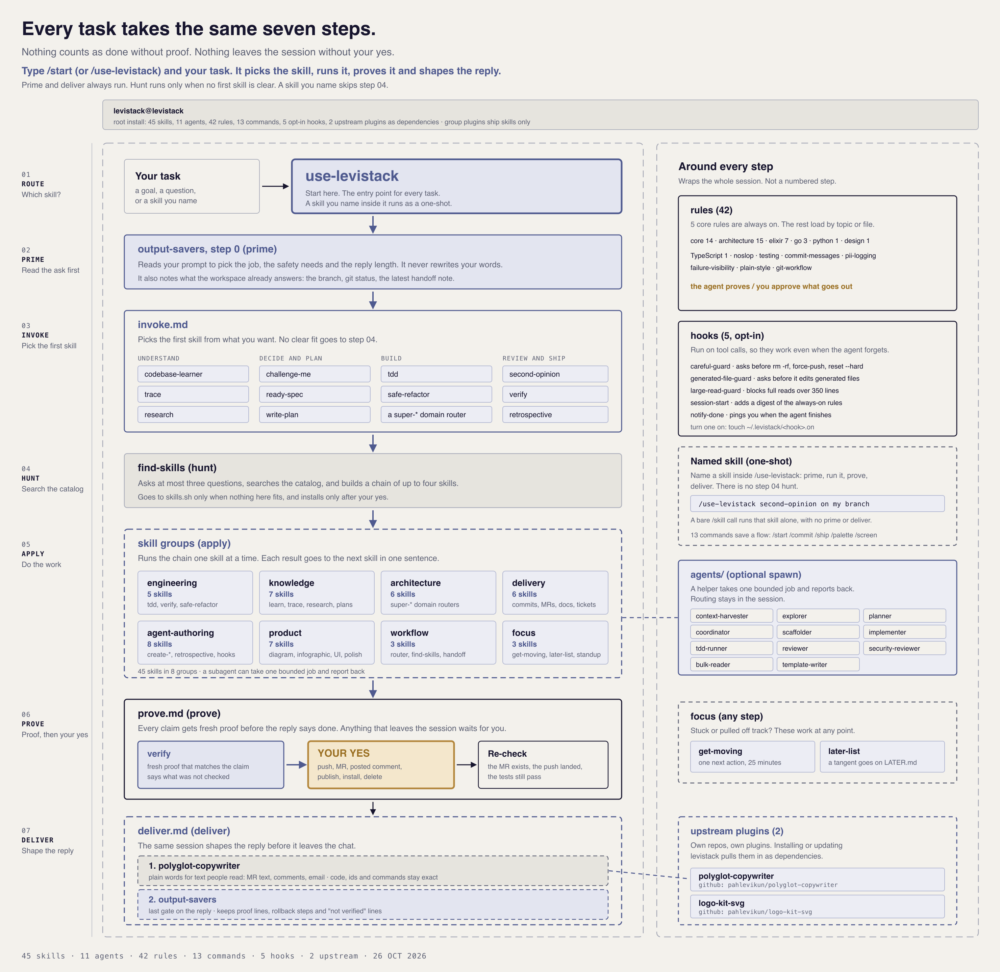

<p align="center">
  
</p>

<h1 align="left">levistack</h1>

<p align="left"><em>Meet Murk, the mug. Overskilled, underslept, and one cron job away from a nap.</em></p>

The agent skills I use every day, in one repo. Skills (plus a few [upstream](#upstream-skills)), subagents, rules and hooks for Claude Code, Codex, Cursor, Antigravity, Trae and the skills CLI.

**Not sure which skill fits?** Start with `/use-levistack <what you want>`. It picks the skill, runs it, proves the result and shapes the reply.

Your agent is fast. It also says "done" before it ran anything, writes like a press release, and forgets your rules by turn ten. I got tired of fixing the same things by hand, so I wrote them down once. This is that.

## Install

Pick one method. Installing through both the skills CLI and the Claude plugin gives you every skill twice.

```bash
# Any agent (skills CLI). Pick skills or whole groups. Upstream skills are separate repos.
npx skills@latest add pahlevikun/levistack
npx skills@latest add pahlevikun/polyglot-copywriter pahlevikun/logo-kit-svg

# Claude Code: the whole stack, or just one group
claude plugin marketplace add pahlevikun/levistack
claude plugin install levistack@levistack   # also installs the upstream skills below
claude plugin install levistack-engineering@levistack

# Codex: same marketplace, same plugin names
codex plugin marketplace add pahlevikun/levistack
codex plugin add levistack@levistack
codex plugin marketplace add pahlevikun/polyglot-copywriter   # upstream skills are their own marketplaces in Codex
codex plugin marketplace add pahlevikun/logo-kit-svg

# Cursor: add the marketplace, then install levistack from Customize > Plugins
agent plugin marketplace add https://github.com/pahlevikun/levistack
# (Teams and Enterprise: Import from Repo with the same URL)

# Antigravity CLI: the repo root is a plugin
agy plugin install https://github.com/pahlevikun/levistack

# Or link a clone: Cursor, the Antigravity app or IDE, and Trae (Trae has no plugin format)
git clone https://github.com/pahlevikun/levistack && cd levistack
./scripts/link-skills.sh --cursor        # links into ~/.cursor/skills and ~/.cursor/agents
./scripts/link-skills.sh --antigravity   # builds ~/.gemini/config/plugins/levistack
./scripts/link-skills.sh --trae          # links into ~/.trae/{skills,agents,rules}
```

Then turn on the hooks you want (next section). What each tool gets, and what I have tested, is in [Status](#status).

## What it fixes

### It says "done" and nothing was run

`verify` makes it show fresh proof that matches the claim. If it could not check something, it says so.

### It writes like a chatbot

`polyglot-copywriter` is the default writing skill. It removes 26 AI tells and uses short, plain sentences. It never adds a fact that was not in your text. This README went through it.

### It ships tutorial code

`noslop` stops generic errors, N+1 queries, filler comments and fake a11y. `output-savers` pushes for the smallest change that works.

### It forgets everything between sessions

`handoff` writes a note a fresh session can pick up cold. `later-list` puts tangents on a list for later so they do not eat the current task. `get-moving` shrinks a foggy goal to one step.

### It runs scary commands

That one is a hook. Read on.

## Hooks

Hooks are the part that works even when the agent forgets the rules. They run on events, so the rule is enforced and not just suggested. All of them are opt-in. Nothing runs until you create a flag file.

| Hook | What it does |
|---|---|
| `careful-guard` | Asks before `rm -rf /`, force-push, `reset --hard`, `git clean -f` and `DROP TABLE` |
| `generated-file-guard` | Asks before the agent edits a file marked "do not edit" or `@generated` |
| `large-read-guard` | Blocks full reads of files over 350 lines and points the agent to `bulk-reader` |
| `session-start` | Injects a short digest of the always-on rules at the start of every session |
| `notify-done` | Pings you when the agent finishes, so you can leave the tab |

```bash
mkdir -p ~/.levistack
touch ~/.levistack/careful-guard.on ~/.levistack/session-start.on
```

Delete the `.on` file to turn one off. Hooks fail open, so a bug in a hook never locks you out. Details and how to write your own: [`hooks/README.md`](hooks/README.md). Claude Code only for now.

## How it works



Every task that goes through [`use-levistack`](skills/workflow/use-levistack/SKILL.md) takes the same seven steps. Steps 2 (prime) and 7 (deliver) always run. Step 4 (hunt) runs only when no first skill is clear.

| Step | What happens | Where it lives |
|---|---|---|
| 1. Route | `use-levistack` takes your task. If you name a skill, it runs as a one-shot. | [`use-levistack`](skills/workflow/use-levistack/SKILL.md) |
| 2. Prime | `output-savers` reads your prompt to pick the job, the safety needs and the reply length. It never rewrites your words. | [`prime.md`](skills/workflow/use-levistack/playbooks/prime.md) |
| 3. Invoke | Pick the first skill from what you want: `codebase-learner`, `trace`, `challenge-me`, `execution-ready-spec-plan`, `tdd`, `second-opinion` and more. No clear fit goes to step 4. | [`invoke.md`](skills/workflow/use-levistack/playbooks/invoke.md) |
| 4. Hunt | `find-skills` asks at most three questions, searches the catalog and builds a chain of up to four skills. It goes to skills.sh only when nothing here fits. | [`find-skills`](skills/workflow/find-skills/SKILL.md) |
| 5. Apply | The chain runs one skill at a time. Each result goes to the next skill. | the [groups](#groups) |
| 6. Prove | `verify` checks every claim with fresh proof. A push, MR, posted comment, install or publish waits for your yes. After it runs, the agent checks the result. | [`prove.md`](skills/workflow/use-levistack/playbooks/prove.md) |
| 7. Deliver | `polyglot-copywriter` puts text for people into plain words. Then `output-savers` runs as the last gate on the reply. | [`deliver.md`](skills/workflow/use-levistack/playbooks/deliver.md) |

Some things sit outside the numbered steps:

- **One-shots.** Name a skill inside `/use-levistack` (for example `/use-levistack second-opinion on my branch`). The router primes, runs that skill, proves and delivers. It skips the step 4 hunt. A bare `/skill` call without the router runs that skill alone.
- **Agents.** In steps 3 to 6 the session can spawn one of the [subagents](docs/agents/README.md) for one bounded job, such as an `explorer` for `codebase-learner` or two reviewers for `second-opinion`. The agent reports back, and the session keeps the steps.
- **Rules and hooks.** The [rules](#rules) apply to the whole session. The [hooks](#hooks) run on tool calls, so they still work when the agent forgets a rule.
- **Focus.** `get-moving` and `later-list` work at any step, when you are stuck or a tangent shows up.
- **Upstream plugins.** `polyglot-copywriter` and `logo-kit-svg` live in their own repos. The `levistack` plugin installs them as [dependencies](#upstream-skills).

## Where to start

You do not need all of them. These are the ones I would try first.

| Skill | What you get |
|---|---|
| [`use-levistack`](skills/workflow/use-levistack/SKILL.md) | Start here. Routes any task through the seven steps above |
| [`verify`](skills/engineering/verify/SKILL.md) | No "it works" without proof. Diagnoses a failure before it edits anything |
| [`tdd`](skills/engineering/tdd/SKILL.md) | One failing test, then the smallest pass, then refactor. Never all tests first |
| [`challenge-me`](skills/knowledge/challenge-me/SKILL.md) | Grills your plan like a critical manager. Numbered questions, each with a recommended answer |
| [`codebase-learner`](skills/knowledge/codebase-learner/SKILL.md) | Reads a repo and writes down what it actually does today |
| [`atomic-semantic-commit`](skills/delivery/atomic-semantic-commit/SKILL.md) | Splits a messy working tree into small commits with clean messages |
| [`write-mr-description`](skills/delivery/write-mr-description/SKILL.md) | Drafts the MR or PR description from your commits, then reviews it |
| [`glab-code-review`](skills/delivery/glab-code-review/SKILL.md) | Reviews your diff before you open the PR, or reviews a GitLab MR with draft inline notes |
| [`standup`](skills/focus/standup/SKILL.md) | Builds today's standup from what you really did yesterday |
| [`polyglot-copywriter`](https://github.com/pahlevikun/polyglot-copywriter) (upstream) | Plain, human prose in 97 languages, from emails to incident updates |
| [`trace`](skills/knowledge/trace/SKILL.md) | Why the code is built that way, or why something broke: a Five Whys chain with evidence on every link, checked before it reaches you |
| [`second-opinion`](skills/knowledge/second-opinion/SKILL.md) | Asks what it needs, has two reviewers on different models tear your branch apart, then walks each finding with you |

Want to build your own? The `agent-authoring` group has a skill for each piece: skills, subagents, rules, hooks, commands and `AGENTS.md`.

## Groups

<!-- groups:start -->
| Group | About | Skills |
|---|---|---|
| `agent-authoring` | Creating agents, skills, rules, hooks, commands and AGENTS.md files for coding assistants. | `convert-as-skill`, `create-agent`, `create-agents-md`, `create-command`, `create-hook`, `create-rule`, `create-skill` |
| `architecture` | System design and stack choices: super-architecture (detect, select, build, evaluate, migrate and document architecture), super-caching, Node backends, super-protobuf, target-stack evaluation and blueprints. | `super-architecture`, `super-caching`, `super-elixir`, `super-nodejs`, `super-protobuf`, `super-tech-blueprint` |
| `delivery` | Shipping work: atomic commits, code review (local diff, request, receive, GitLab glab drafts), merge request descriptions, tickets and API collections. | `atomic-semantic-commit`, `create-bruno-collection`, `create-jira-story`, `glab-code-review`, `write-mr-description` |
| `engineering` | Engineering habits: tdd (test-first red-green-refactor across stacks), safe-refactor (behavior-preserving refactors), verify (evidence before claims), noslop (no-slop filter for backend, API, frontend, database, config and comments) and output-savers (YAGNI, DRY, SOLID and plain STE replies). | `noslop`, `output-savers`, `safe-refactor`, `tdd`, `verify` |
| `focus` | ADHD-friendly daily tools: shrink a task to one next action, list tangents for later, and write today's standup from what you really did. | `get-moving`, `later-list`, `standup` |
| `knowledge` | Understand, question and plan: how the code works today (one flow or the whole repo), why it is shaped that way or why it broke (trace), a second opinion on a change, grilling plans, execution-ready API specs and step-by-step implementation plans. | `challenge-me`, `codebase-learner`, `execution-ready-spec-plan`, `second-opinion`, `trace`, `write-plan` |
| `product` | Product and UI work on a real product: audit, user-journey QA, UI/UX polish, design systems, tokens, branding and motion. | `design-system-kit`, `product-polish-workflow` |
| `workflow` | How to work with this stack: the use-levistack entry point and router, finding and installing skills, and handing a session off to the next one. | `find-skills`, `handoff`, `use-levistack` |
<!-- groups:end -->

## Upstream skills

These skills live in their own repos and ship as their own plugins. The levistack marketplace lists them as GitHub sources, and the `levistack` plugin depends on them. Installing or updating levistack (`claude plugin marketplace update levistack`) installs and updates them too. Edit them in their own repo; the list lives in [`upstream.json`](upstream.json).

<!-- upstream:start -->
| Skill | About |
|---|---|
| [`polyglot-copywriter`](https://github.com/pahlevikun/polyglot-copywriter) | Default writing skill for everyday prose: write, rewrite, humanize and de-AI text in simple words, 97 languages and 163 dialect overlays. |
| [`logo-kit-svg`](https://github.com/pahlevikun/logo-kit-svg) | Ship a four-file SVG brand system (icon and README banner, static and animated) plus a tiered kit: platform icons, social cards and boards, with script QA. |
<!-- upstream:end -->

## Subagents

Generic ones in `agents/`. They carry no project names. Your project's own `AGENTS.md` supplies the specifics.

The usual flow: `context-harvester` first, then `planner`, `coordinator`, `explorer` or `scaffolder`, then `implementer` or `tdd-runner`, and `reviewer` at the end (plus `security-reviewer` when you touch a trust boundary). Two of them, `bulk-reader` and `template-writer`, run on a small model on purpose, so keep judgment work away from them. Full roster: [`docs/agents/README.md`](docs/agents/README.md).

## Rules

Rules in `rules/`, by topic: `core`, `architecture`, `elixir`, `go`, `python` and `design`. The core ones cover things like commit messages, comments, testing, failure visibility and PII in logs. Cursor `.mdc` copies are generated into `generated/cursor/rules/`.

## Also in the box

- `commands/`: slash commands. `/handoff` is the one I use most.
- `statusline/`: a one-line status for Claude Code, Cursor CLI and Codex. It shows the branch, model, your 5-hour and weekly limits, and context use. `node scripts/install-statusline.mjs --dry-run` first. See [`statusline/README.md`](statusline/README.md).
- Import provenance lives next to vendored code (for example `skills/agent-authoring/convert-as-skill/scripts/extractor/UPSTREAM.md` and `LICENSE.md`), not in a repo-root file.

## Status

| Install path | State |
|---|---|
| `npx skills add` (nested `skills/<group>/<skill>`) | Not yet verified against the published repo |
| Claude Code marketplace and per-group plugins | Check with `claude plugin validate . --strict` |
| Cursor plugin | `.cursor-plugin/` lists every skill by path (the nested layout needs it, the same way official Cursor plugins such as CockroachDB do), plus `agents/` and the generated `.mdc` rules. Not load-tested in the Cursor app. `link-skills.sh --cursor` links skills and agents into `~/.cursor` |
| Codex plugin | Tested with Codex CLI 0.163: installs from this repo's marketplace and loads every skill (it also lists the inner mode files of `output-savers` and `noslop` as skills). Upstream plugins are separate marketplaces in Codex. No agents, rules or hooks |
| Antigravity | Root `plugin.json` and `.antigravity-plugin/plugin.json` for `agy plugin install`, and `link-skills.sh --antigravity` for the app and IDE (flat `skills/`, `agents/`, the always-on core rules). Not load-tested: Antigravity's docs do not say if the nested `skills/<group>/` layout of a GitHub install is found, so use the link script if skills are missing |
| Trae | No plugin format. `link-skills.sh --trae` links skills, agents (`levistack-*.md`) and the always-on core rules into `~/.trae`. Not load-tested |
| Hooks | Claude Code only |

## Develop

```bash
npm run sync               # regenerate manifests and the group table above
npm run check              # sync --check, validate, tests
./scripts/link-skills.sh   # symlink skills into ~/.claude/skills and ~/.agents/skills
./scripts/link-skills.sh --all --dry-run   # also Trae and Antigravity, printed first
```

Needs Node 20 or newer. To add a skill, create `skills/<group>/<name>/SKILL.md`, run `npm run sync`, then `npm run check`. Conventions are in [`AGENTS.md`](AGENTS.md).

PRs and issues are welcome. If a skill never triggers or gets in your way, tell me. That is how these got better.

## Releasing

Push a version tag and GitHub creates the release for you. Notes are built from commit messages and merged PR titles, so prefixes like `feat:`, `fix:` and `docs:` keep them easy to scan.

```bash
git tag v1.1.0
git push origin v1.1.0
```
