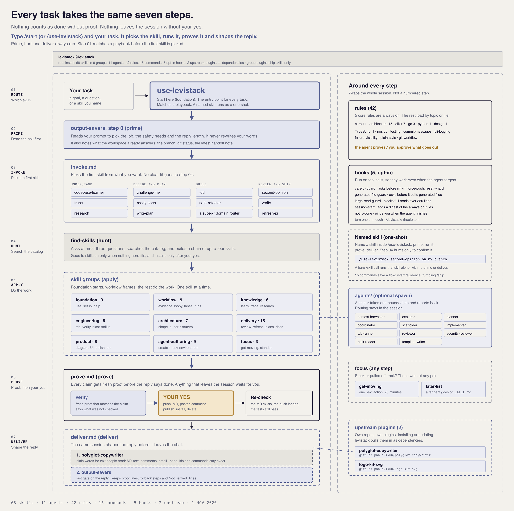
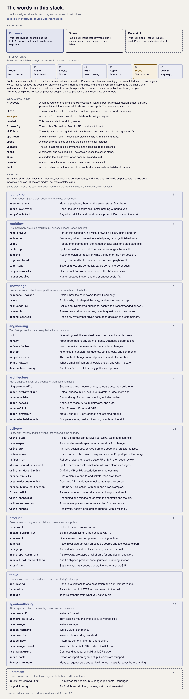

<p align="center">
  
</p>

<h1 align="left">levistack</h1>

<p align="left"><em>Meet Murk, the mug. Overskilled, underslept, and one cron job away from a nap.</em></p>

The agent skills I use every day, in one repo. 65 skills (plus 2 [upstream](#upstream-skills)), 11 subagents, 42 rules, 15 commands and 5 hooks for Claude Code, Codex, Cursor, Antigravity, Trae and the skills CLI.

**Not sure which skill fits?** Start with `/use-levistack <what you want>`. It picks the skill, runs it, checks the result, and writes the reply in plain words.

Your agent is fast. It also says "done" before it ran anything, writes like a press release, and forgets your rules by turn ten. I got tired of fixing the same things by hand, so I wrote them down once. This is that.

## What it's for

Use this repo when a coding agent works on a product that already exists.

Type `/use-levistack` and the task. The run checks this machine first. If Node or Python is missing, `setup-levistack` runs before the work starts. Then it picks one playbook and walks seven steps: route, prime, invoke, hunt, apply, prove, deliver. Hunt runs every time, even when the first skill is already clear. If the task is not finished when the session ends, it writes a handoff note.

Ask `/help-levistack` when you only want to know which skill fits. That does not start the work.

### The playbooks

Each playbook is one kind of task. The seven steps still run.

| Playbook | Use it when |
|---|---|
| investigate | You need to know how the code works, or why it is shaped this way. |
| feature | You are adding behavior. Types and module shape are settled before the code. |
| bug-fix | Something is broken. Find the cause, then fix it with a test. |
| refactor | The behavior stays the same. The structure changes. |
| design-shape | You want the types and the module shape before anyone writes the real code. |
| parallel | Several pieces can run at once. The pieces do not edit the same files. |
| prove-outside-diff | You need to know what a small change can break outside its own diff. |
| open-ended | The job is large, and no smaller playbook fits. The run keeps a decision log. |

Two extra loops sit on top of a playbook. `loopy` repeats one change until the checks you named pass. `rumbling` runs parallel tries, then `evidence` judges the result.

### Learn, then build

`codebase-learner` explains the code as it is today. `trace` explains why it is that way. `challenge-me` questions a plan before you build. `research` answers from sources, or writes questions for one person.

`shape-and-build` settles types and module shape, then builds one of them. Node.js, Elixir, and protobuf each have a full skill. Go, Python, and TypeScript have rules. `tdd` writes one failing test, then the smallest code that passes. `safe-refactor` changes structure and keeps behavior. `output-savers` keeps the change small. `noslop` filters tutorial code and filler comments. `dev-cache-cleanup` lists old build caches and deletes only the paths you approve.

### Check, then ship

`verify` asks for fresh proof before anyone says the work is done. `blast-radius` looks past the diff. `second-opinion` reviews the branch and asks you to decide each open question.

`code-review` reviews a diff or a merge request. Watch stays until it is clean. Prep stops before merge. `refresh-pr` decides whether an old request should be updated, rewritten, or closed. `atomic-semantic-commit` splits a messy tree into small commits. `write-mr-description` drafts the request text for GitLab or GitHub.

The same group writes the spec, the plan, the tickets, the API collection, the docs, the changelog, the postmortem, and the runbook.

### Screens, files, and the session

You can check color contrast, build a design system, design one screen, sketch a throwaway page, or polish a product that already shipped. Screens include iOS, Android, React Native, Flutter, web, desktop, car, and TV. Diagrams, explainers, and short original art each have their own skill. The SVG logo lives in [`logo-kit-svg`](https://github.com/pahlevikun/logo-kit-svg). Documents, spreadsheets, slides, images, and audio go through `file-toolkit`. Writing for people goes through [`polyglot-copywriter`](https://github.com/pahlevikun/polyglot-copywriter), in 97 languages, without adding facts.

`get-moving` shrinks a stuck task to one next step. `later-list` parks a side idea. `standup` writes today's update from what you actually did. `handoff` leaves a note the next session can read. `lane-lead` runs several lanes under one controller. Those lanes do not merge. `compare-models` runs one prompt on two or three models. `retrospective` names a repeated snag and one useful fix.

The agent-authoring group writes skills, agents, rules, hooks, commands, and `AGENTS.md`. `mcp-management` connects or builds an MCP server. `dev-environment` moves an agent setup and a Mac workstation in or out, and waits for a yes before it writes.

Five hooks can block a dangerous command or load the always-on rules. They run in Claude Code, and only after you turn one on.

### What is not here

There is no skill for Kubernetes, data science, or training a model.
Terraform shows up only inside `safe-refactor`, as one option when you split a module and keep the same behavior.
Phone and TV apps are covered as screens and motion, not as full app kits.
The helper agents do not name your product. Your project's `AGENTS.md` names the product, the commands, and the limits.

## Install

Pick one method. Installing through both the skills CLI and the Claude plugin gives you every skill twice.

```bash
# Any agent (skills CLI). Pick skills or whole groups. Upstream skills are separate repos.
npx skills@latest add pahlevikun/levistack
npx skills@latest add pahlevikun/polyglot-copywriter pahlevikun/logo-kit-svg

# Claude Code: the whole stack, or just one group
claude plugin marketplace add pahlevikun/levistack
claude plugin install levistack@levistack   # also installs the upstream skills below
claude plugin install levistack-engineering@levistack

# Codex: same marketplace, same plugin names
codex plugin marketplace add pahlevikun/levistack
codex plugin add levistack@levistack
codex plugin marketplace add pahlevikun/polyglot-copywriter   # upstream skills are their own marketplaces in Codex
codex plugin marketplace add pahlevikun/logo-kit-svg

# Cursor: add the marketplace, then install levistack from Customize > Plugins
agent plugin marketplace add https://github.com/pahlevikun/levistack
# (Teams and Enterprise: Import from Repo with the same URL)

# Antigravity CLI: the repo root is a plugin
agy plugin install https://github.com/pahlevikun/levistack

# Or link a clone: Cursor, the Antigravity app or IDE, and Trae (Trae has no plugin format)
git clone https://github.com/pahlevikun/levistack && cd levistack
./scripts/link-skills.sh --cursor        # links into ~/.cursor/skills and ~/.cursor/agents
./scripts/link-skills.sh --antigravity   # builds ~/.gemini/config/plugins/levistack
./scripts/link-skills.sh --trae          # links into ~/.trae/{skills,agents,rules}
```

Then turn on the hooks you want (next section). What each tool gets, and what I have tested, is in [Status](#status).

## What it fixes

### It says "done" and nothing was run

`verify` makes it show fresh proof that matches the claim. If it could not check something, it says so.

### It writes like a chatbot

`polyglot-copywriter` is the default writing skill. It removes 26 AI tells and uses short, plain sentences. It never adds a fact that was not in your text. This README went through it.

### It ships tutorial code

`noslop` stops generic errors, N+1 queries, filler comments and fake a11y. `output-savers` pushes for the smallest change that works.

### It forgets everything between sessions

`handoff` writes a note a fresh session can pick up cold. `later-list` puts tangents on a list for later so they do not eat the current task. `get-moving` shrinks a foggy goal to one step.

### It runs scary commands

That one is a hook. Read on.

## Hooks

Hooks are the part that works even when the agent forgets the rules. They run on events, so the rule is enforced and not just suggested. All of them are opt-in. Nothing runs until you create a flag file.

| Hook | What it does |
|---|---|
| `careful-guard` | Asks before `rm -rf /`, force-push, `reset --hard`, `git clean -f` and `DROP TABLE` |
| `generated-file-guard` | Asks before the agent edits a file marked "do not edit" or `@generated` |
| `large-read-guard` | Blocks full reads of files over 350 lines and points the agent to `bulk-reader` |
| `session-start` | Injects a short digest of the always-on rules at the start of every session |
| `notify-done` | Pings you when the agent finishes, so you can leave the tab |

```bash
mkdir -p ~/.levistack
touch ~/.levistack/careful-guard.on ~/.levistack/session-start.on
```

Delete the `.on` file to turn one off. Hooks fail open, so a bug in a hook never locks you out. Details and how to write your own: [`hooks/README.md`](hooks/README.md). Claude Code only for now.

## How it works



Every task that goes through [`use-levistack`](skills/foundation/use-levistack/SKILL.md) checks this machine first. If `node` or `python3` is missing, [`setup-levistack`](skills/foundation/setup-levistack/SKILL.md) runs first, and the task waits. Then it picks a playbook (investigate, feature, bug-fix, refactor, design-shape, parallel, prove-outside-diff, or open-ended) and takes the same seven steps. Prime, hunt, and deliver always run. A missing optional tool is named. It does not stop the route.

The groups have jobs. **Foundation** is the front door: start a task, check the machine, or ask how. **Workflow** is the work around a result: search, evidence, loops, lanes, handoffs, and runs you can audit. **Product, knowledge, engineering, delivery, and architecture** do the work. A playbook or the hunt picks them. You can also name a skill yourself. **Focus** is for the session itself. **Agent-authoring** builds this catalog. A bare `/skill` call runs that skill alone.

| Step | What happens | Where it lives |
|---|---|---|
| 0. Machine | Check `node` 20+ and `python3`. Ready, including named gaps: continue. Blocked: `setup-levistack` first. | [`setup-levistack`](skills/foundation/setup-levistack/SKILL.md) |
| 1. Route | `use-levistack` takes your task and matches a playbook. If you name a skill, it runs as a one-shot. | [`use-levistack`](skills/foundation/use-levistack/SKILL.md) |
| 2. Prime | `output-savers` reads your prompt to pick the job, the safety needs and the reply length. It never rewrites your words. | [`prime.md`](skills/foundation/use-levistack/playbooks/prime.md) |
| 3. Invoke | Pick the first skill from what you want: `codebase-learner`, `trace`, `challenge-me`, `ready-spec`, `tdd`, `second-opinion`, `evidence`, `rumbling` and more. No clear fit goes to step 4. | [`invoke.md`](skills/foundation/use-levistack/playbooks/invoke.md) |
| 4. Hunt | `find-skills` asks at most three questions, searches the catalog and builds a chain of up to four skills. It goes to skills.sh only when nothing here fits. | [`find-skills`](skills/workflow/find-skills/SKILL.md) |
| 5. Apply | The chain runs one skill at a time. Each result goes to the next skill. | the [groups](#groups) |
| 6. Prove | `verify` checks every claim with fresh proof. A push, MR, posted comment, install or publish waits for your yes. After it runs, the agent checks the result. | [`prove.md`](skills/foundation/use-levistack/playbooks/prove.md) |
| 7. Deliver | `polyglot-copywriter` puts text for people into plain words. Then `output-savers` runs as the last gate on the reply. | [`deliver.md`](skills/foundation/use-levistack/playbooks/deliver.md) |

Some things sit outside the numbered steps:

- **One-shots.** Name a skill inside `/use-levistack` (for example `/use-levistack second-opinion on my branch`). The router primes, runs that skill, hunts to confirm it, proves and delivers. A bare `/skill` call without the router runs that skill alone.
- **Agents.** In steps 3 to 6 the session can spawn one of the [subagents](docs/agents/README.md) for one small job. `rumbling` runs independent tasks, competing solutions, or a review panel. `evidence` judges the finished batch. The session keeps the seven steps.
- **Rules and hooks.** The [rules](#rules) apply to the whole session. The [hooks](#hooks) run on tool calls, so they still work when the agent forgets a rule.
- **Focus.** `get-moving` and `later-list` work at any step, when you are stuck or a tangent shows up.
- **Upstream plugins.** `polyglot-copywriter` and `logo-kit-svg` live in their own repos. The `levistack` plugin installs them as [dependencies](#upstream-skills).

## Glossary



Same words, as text you can search. The [Groups](#groups) table further down is generated from the tree.

<!-- glossary-body:start -->
### How to use

Three ways to start. On the full route and on a one-shot, the machine check runs first. If `node` or `python3` is missing, `setup-levistack` runs before the steps. A bare skill does not run that check.

| Way | What you type | What runs |
|---|---|---|
| Full route | `/use-levistack` or `/start`, and the task | A machine check, then a playbook and all seven steps. |
| One-shot | A skill name inside that command | Prime, that skill, hunt to confirm, prove, deliver. |
| Bare skill | `/skill` alone | That skill only. Prime, hunt, and deliver stay off. |

Prime, hunt, and deliver always run on the full route and on a one-shot.

| Step | Word | What it does |
|---|---|---|
| 1 | Route | Match a playbook, or mark a named skill as a one-shot. |
| 2 | Prime | output-savers reads your prompt for the job, the safety needs, and the reply length. It does not rewrite your words. |
| 3 | Invoke | Restate the goal, then pick the first skill. |
| 4 | Hunt | find-skills searches this catalog. This step runs every time. |
| 5 | Apply | The chain runs, one skill at a time. At most four skills. |
| 6 | Prove | verify shows fresh proof. A push, MR, comment, install, or publish waits for your yes. |
| 7 | Deliver | polyglot-copywriter shapes prose for people. output-savers is the last gate on the reply. |

| Word | Means |
|---|---|
| Playbook | A named route for one kind of task: investigate, feature, bug-fix, refactor, design-shape, parallel, prove-outside-diff, open-ended. It fills invoke and apply. The seven steps still run. |
| Chain | The skills for this task, at most four. Each one prepares, does the work, or verifies. |
| Your yes | A push, MR, comment, install, or publish waits until you agree. |
| Loaded | This host can start the skill by name. |
| File-only | The skill is a file on disk. Read its SKILL.md and follow it. |
| skills.sh | The only outside catalog find-skills may browse, and only after this catalog has no fit. |
| Upstream | A skill in its own repo. The levistack plugin installs it. Edit it in that repo. |
| Group | A folder of skills. It also ships as the plugin `levistack-<group>`. |
| Catalog | The skills, agents, rules, commands, and hooks this repo publishes. |
| Agent | A helper for one bounded job. The session keeps the seven steps. |
| Rule | A standard that holds even when nobody invoked a skill. |
| Command | A saved prompt you run as /name. /start runs use-levistack. |
| Hook | An opt-in check on a tool event. It runs only after you create `~/.levistack/<name>.on`. |

### Groups

Order follows the path: front door, machinery, the work, the session, the catalog, then upstream.

| Group | What it is | Skills |
|---|---|---|
| [`foundation`](skills/foundation/DESCRIPTION.md) | The front door. Start a task, check the machine, or ask how. | 3 |
| [`workflow`](skills/workflow/DESCRIPTION.md) | The machinery around a result: hunt, evidence, loops, lanes, handoff. | 9 |
| [`knowledge`](skills/knowledge/DESCRIPTION.md) | How code works, why it is shaped that way, and whether a plan holds. | 5 |
| [`engineering`](skills/engineering/DESCRIPTION.md) | Test first, prove the claim, keep behavior, and cut slop. | 7 |
| [`architecture`](skills/architecture/DESCRIPTION.md) | Pick a shape, a stack, or a boundary, then build against it. | 7 |
| [`delivery`](skills/delivery/DESCRIPTION.md) | Spec, plan, review, and the writing that ships with the change. | 14 |
| [`product`](skills/product/DESCRIPTION.md) | Color, screens, diagrams, explainers, prototypes, and polish. | 8 |
| [`focus`](skills/focus/DESCRIPTION.md) | The session itself. One next step, a later list, today's standup. | 3 |
| [`agent-authoring`](skills/agent-authoring/DESCRIPTION.md) | Skills, agents, rules, commands, hooks, and whole setups. | 9 |
| [`upstream`](upstream.json) | Their own repos. The levistack plugin installs them. Edit them there. | 2 |

### Every skill

65 catalog skills, plus 2 upstream. concise, concise-light, concise-heavy, and principles live inside output-savers. noslop-code lives inside noslop. Those are modes, not extra skills.

#### foundation

| Skill | Does |
|---|---|
| [`use-levistack`](skills/foundation/use-levistack/SKILL.md) | Check the machine, match a playbook, then run the seven steps. |
| [`setup-levistack`](skills/foundation/setup-levistack/SKILL.md) | Check the tools scripts call. Install nothing without a yes. |
| [`help-levistack`](skills/foundation/help-levistack/SKILL.md) | Say which skill fits and hand back a prompt. Do not start the work. |

#### workflow

| Skill | Does |
|---|---|
| [`find-skills`](skills/workflow/find-skills/SKILL.md) | Search this catalog. On a miss, browse skills.sh, install, and run. |
| [`evidence`](skills/workflow/evidence/SKILL.md) | Frame a goal, run one evidence-led pass, or judge finished work. |
| [`loopy`](skills/workflow/loopy/SKILL.md) | Repeat one change until the named checks pass or a stop state hits. |
| [`rumbling`](skills/workflow/rumbling/SKILL.md) | Split, Contest, or Council. Then evidence judges the result. |
| [`handoff`](skills/workflow/handoff/SKILL.md) | Resume, catch up, recall, or write the note for the next session. |
| [`figure-it-out`](skills/workflow/figure-it-out/SKILL.md) | Design one auditable run when no narrower playbook fits. |
| [`lane-lead`](skills/workflow/lane-lead/SKILL.md) | Several lanes, one controller. Lanes do not merge or push. |
| [`compare-models`](skills/workflow/compare-models/SKILL.md) | One prompt on two or three models this host can spawn. |
| [`retrospective`](skills/workflow/retrospective/SKILL.md) | Name repeated friction and the strongest useful fix. |

#### knowledge

| Skill | Does |
|---|---|
| [`codebase-learner`](skills/knowledge/codebase-learner/SKILL.md) | Explain how the code works today. Read-only. |
| [`trace`](skills/knowledge/trace/SKILL.md) | Explain why it is shaped this way, evidence on every step. |
| [`challenge-me`](skills/knowledge/challenge-me/SKILL.md) | Grill a plan. Numbered questions, each with a recommended answer. |
| [`research`](skills/knowledge/research/SKILL.md) | Answer from primary sources, or write questions for one person. |
| [`second-opinion`](skills/knowledge/second-opinion/SKILL.md) | Read-only review that drives each open decision to a commitment. |

#### engineering

| Skill | Does |
|---|---|
| [`tdd`](skills/engineering/tdd/SKILL.md) | One failing test, the smallest pass, then refactor while green. |
| [`verify`](skills/engineering/verify/SKILL.md) | Fresh proof before any claim of done. Diagnose before editing. |
| [`safe-refactor`](skills/engineering/safe-refactor/SKILL.md) | Keep behavior the same while the structure changes. |
| [`noslop`](skills/engineering/noslop/SKILL.md) | Filter slop in handlers, UI, queries, config, tests, and comments. |
| [`output-savers`](skills/engineering/output-savers/SKILL.md) | The smallest change, named principles, and plain replies. |
| [`blast-radius`](skills/engineering/blast-radius/SKILL.md) | What a small diff can break outside itself, and why it is safe. |
| [`dev-cache-cleanup`](skills/engineering/dev-cache-cleanup/SKILL.md) | Audit dev caches. Delete only paths you approved. |

#### architecture

| Skill | Does |
|---|---|
| [`shape-and-build`](skills/architecture/shape-and-build/SKILL.md) | Settle types and module shape, compare two, then build one. |
| [`super-architecture`](skills/architecture/super-architecture/SKILL.md) | Detect, choose, build, evaluate, migrate, or document one. |
| [`super-caching`](skills/architecture/super-caching/SKILL.md) | Cache design for web and mobile, including offline. |
| [`super-nodejs`](skills/architecture/super-nodejs/SKILL.md) | Node.js services, APIs, middleware, and auth. |
| [`super-elixir`](skills/architecture/super-elixir/SKILL.md) | Elixir, Phoenix, Ecto, and OTP. |
| [`super-protobuf`](skills/architecture/super-protobuf/SKILL.md) | proto3, buf, gRPC or Connect, and schema breaks. |
| [`super-tech-blueprint`](skills/architecture/super-tech-blueprint/SKILL.md) | Compare stacks, cost a migration, or write a blueprint. |

#### delivery

| Skill | Does |
|---|---|
| [`write-plan`](skills/delivery/write-plan/SKILL.md) | A plan a stranger can follow: files, tasks, tests, and commits. |
| [`ready-spec`](skills/delivery/ready-spec/SKILL.md) | An execution-ready spec for a backend or API change. |
| [`write-adr`](skills/delivery/write-adr/SKILL.md) | An ADR, design doc, or RFC from the code and real alternatives. |
| [`code-review`](skills/delivery/code-review/SKILL.md) | Review a diff or MR. Watch stays until clean. Prep stops before merge. |
| [`refresh-pr`](skills/delivery/refresh-pr/SKILL.md) | Refresh, rework, or close a stale PR or MR, then code-review. |
| [`atomic-semantic-commit`](skills/delivery/atomic-semantic-commit/SKILL.md) | Split a messy tree into small commits with clean messages. |
| [`write-mr-description`](skills/delivery/write-mr-description/SKILL.md) | Draft the MR or PR description from the commits. |
| [`create-tickets`](skills/delivery/create-tickets/SKILL.md) | Slice a plan into end-to-end tickets, then draft them. |
| [`create-documentation`](skills/delivery/create-documentation/SKILL.md) | Docs and API handovers checked against the source. |
| [`create-bruno-collection`](skills/delivery/create-bruno-collection/SKILL.md) | A Bruno API collection, with auth and error examples. |
| [`file-toolkit`](skills/delivery/file-toolkit/SKILL.md) | Parse, create, or convert documents, images, and audio. |
| [`write-changelog`](skills/delivery/write-changelog/SKILL.md) | Changelog and release notes from the commits and the diff. |
| [`write-postmortem`](skills/delivery/write-postmortem/SKILL.md) | A blameless postmortem or near-miss, from evidence. |
| [`write-runbook`](skills/delivery/write-runbook/SKILL.md) | A recovery, deploy, or migration runbook with a rollback. |

#### product

| Skill | Does |
|---|---|
| [`color-kit`](skills/product/color-kit/SKILL.md) | Pick colors and prove contrast. |
| [`design-system-kit`](skills/product/design-system-kit/SKILL.md) | Build a design system, then critique with it. |
| [`ui-ux-kit`](skills/product/ui-ux-kit/SKILL.md) | One screen or one component, including motion. |
| [`diagram`](skills/product/diagram/SKILL.md) | A technical diagram with an editable source and a checked export. |
| [`infographic`](skills/product/infographic/SKILL.md) | An evidence-based explainer, chart, timeline, or poster. |
| [`prototype-wireframe`](skills/product/prototype-wireframe/SKILL.md) | A throwaway prototype or wireframe for one design question. |
| [`product-polish-workflow`](skills/product/product-polish-workflow/SKILL.md) | Audit a shipped product: code, journeys, branding, motion. |
| [`visual-art`](skills/product/visual-art/SKILL.md) | Static canvas art, seeded generative art, or a short GIF. |

#### focus

| Skill | Does |
|---|---|
| [`get-moving`](skills/focus/get-moving/SKILL.md) | Shrink a stuck task to one next action and a 25-minute round. |
| [`later-list`](skills/focus/later-list/SKILL.md) | Park a tangent in LATER.md and return to the task. |
| [`standup`](skills/focus/standup/SKILL.md) | Today's standup from what you actually did. |

#### agent-authoring

| Skill | Does |
|---|---|
| [`create-skill`](skills/agent-authoring/create-skill/SKILL.md) | Write or fix a skill. |
| [`convert-as-skill`](skills/agent-authoring/convert-as-skill/SKILL.md) | Turn existing material into a skill, or merge skills. |
| [`create-agent`](skills/agent-authoring/create-agent/SKILL.md) | Write a subagent. |
| [`create-command`](skills/agent-authoring/create-command/SKILL.md) | Write a slash command. |
| [`create-rule`](skills/agent-authoring/create-rule/SKILL.md) | Write a rule or coding standard. |
| [`create-hook`](skills/agent-authoring/create-hook/SKILL.md) | Automate something on an agent event. |
| [`create-agents-md`](skills/agent-authoring/create-agents-md/SKILL.md) | Write or refresh AGENTS.md or CLAUDE.md. |
| [`mcp-management`](skills/agent-authoring/mcp-management/SKILL.md) | Connect, diagnose, or build an MCP server. |
| [`dev-environment`](skills/agent-authoring/dev-environment/SKILL.md) | Move an agent setup and a Mac in or out. Waits for a yes before writing. |

#### upstream

| Skill | Does |
|---|---|
| [`polyglot-copywriter`](https://github.com/pahlevikun/polyglot-copywriter) | Plain prose for people, in 97 languages, facts unchanged. |
| [`logo-kit-svg`](https://github.com/pahlevikun/logo-kit-svg) | An SVG brand kit: icon, banner, static, and animated. |
<!-- glossary-body:end -->

## Where to start

You do not need all of them. These are the ones I would try first.

| Skill | What you get |
|---|---|
| [`use-levistack`](skills/foundation/use-levistack/SKILL.md) | Start here. Checks the machine, matches a playbook, then routes the task through the seven steps above |
| [`setup-levistack`](skills/foundation/setup-levistack/SKILL.md) | Checks the tools levistack scripts call and writes `~/.levistack/setup.md`. Installs nothing without a yes |
| [`help-levistack`](skills/foundation/help-levistack/SKILL.md) | Answers which skill or playbook fits and hands back a prompt. Does not start the work |
| [`verify`](skills/engineering/verify/SKILL.md) | No "it works" without proof. Diagnoses a failure before it edits anything |
| [`tdd`](skills/engineering/tdd/SKILL.md) | One failing test, then the smallest pass, then refactor. Never all tests first |
| [`challenge-me`](skills/knowledge/challenge-me/SKILL.md) | Grills your plan like a critical manager. Numbered questions, each with a recommended answer |
| [`codebase-learner`](skills/knowledge/codebase-learner/SKILL.md) | Reads a repo and writes down what it actually does today |
| [`atomic-semantic-commit`](skills/delivery/atomic-semantic-commit/SKILL.md) | Splits a messy working tree into small commits with clean messages |
| [`write-mr-description`](skills/delivery/write-mr-description/SKILL.md) | Drafts the MR or PR description from your commits, then reviews it |
| [`code-review`](skills/delivery/code-review/SKILL.md) | Reviews local changes or a GitLab MR. Watch stays until it is clean. Prep stops before merge |
| [`refresh-pr`](skills/delivery/refresh-pr/SKILL.md) | Decides whether a stale PR or MR should be refreshed, reworked, or closed, then hands it to `code-review` |
| [`figure-it-out`](skills/workflow/figure-it-out/SKILL.md) | Designs a run you can audit when no smaller playbook fits, and keeps a decision log |
| [`dev-environment`](skills/agent-authoring/dev-environment/SKILL.md) | Moves an agent setup and a Mac in or out. Waits for a yes before it writes |
| [`standup`](skills/focus/standup/SKILL.md) | Builds today's standup from what you really did yesterday |
| [`polyglot-copywriter`](https://github.com/pahlevikun/polyglot-copywriter) (upstream) | Plain, human prose in 97 languages, from emails to incident updates |
| [`trace`](skills/knowledge/trace/SKILL.md) | Why the code is built that way, or why something broke: a Five Whys chain with evidence on every link, checked before it reaches you |
| [`second-opinion`](skills/knowledge/second-opinion/SKILL.md) | Asks what it needs, has two reviewers on different models tear your branch apart, then walks each finding with you |
| [`evidence`](skills/workflow/evidence/SKILL.md) | Frames a goal or checks completed work against the actual artifact and proof |
| [`rumbling`](skills/workflow/rumbling/SKILL.md) | Coordinates parallel agents, integrates one result, then calls `evidence` to judge it |

Want to build your own? The `agent-authoring` group has a skill for each piece: skills, subagents, rules, hooks, commands and `AGENTS.md`.

## Groups

<!-- groups:start -->
| Group | About | Skills |
|---|---|---|
| `agent-authoring` | Create agents, skills, rules, hooks, commands and AGENTS.md files for coding assistants. Includes MCP connection configuration, protocol diagnosis, server scaffolding and evaluation, exporting or importing an agent setup from a directory or git, and backing up or restoring a Mac developer workstation. | `convert-as-skill`, `create-agent`, `create-agents-md`, `create-command`, `create-hook`, `create-rule`, `create-skill`, `dev-environment`, `mcp-management` |
| `architecture` | System design and stack choices: super-architecture (detect, select, build, evaluate, migrate and document architecture), super-caching, Node backends, super-protobuf, target-stack evaluation and blueprints. | `shape-and-build`, `super-architecture`, `super-caching`, `super-elixir`, `super-nodejs`, `super-protobuf`, `super-tech-blueprint` |
| `delivery` | Shipping work: atomic commits, code review, merge request descriptions, implementation specs and plans, technical documentation (pages, Bruno-first API handovers with full responses and states, processes, contracts, doc comments and freshness checks), combined ADR and design-doc authoring, dedicated runbook, postmortem and changelog skills, tickets and API collections. Includes a reusable document, image and audio file toolkit for parsing, creation and conversion. | `atomic-semantic-commit`, `code-review`, `create-bruno-collection`, `create-documentation`, `create-tickets`, `file-toolkit`, `ready-spec`, `refresh-pr`, `write-adr`, `write-changelog`, `write-mr-description`, `write-plan`, `write-postmortem`, `write-runbook` |
| `engineering` | Engineering habits: tdd (test-first red-green-refactor across stacks), safe-refactor (behavior-preserving refactors), verify (evidence before claims), noslop (no-slop filter for backend, API, frontend, database, config and comments) and output-savers (YAGNI, DRY, SOLID and plain STE replies). Includes scoped disk-usage audits and exact-plan cleanup of eligible development caches across Node.js, web, mobile, and backend projects. | `blast-radius`, `dev-cache-cleanup`, `noslop`, `output-savers`, `safe-refactor`, `tdd`, `verify` |
| `focus` | ADHD-friendly daily tools: shrink a task to one next action, list tangents for later, and write today's standup from what you really did. | `get-moving`, `later-list`, `standup` |
| `foundation` | Where to start with levistack: use-levistack routes a task through a situational playbook and seven steps, setup-levistack checks the tools scripts need, and help-levistack answers how to use the catalog without starting work. | `help-levistack`, `setup-levistack`, `use-levistack` |
| `knowledge` | Understand code, trace causes, challenge plans, research primary sources or interview questions, and review a diff for blind spots. | `challenge-me`, `codebase-learner`, `research`, `second-opinion`, `trace` |
| `product` | Design systems, colors and themes, screens and interactions, technical diagrams and Mermaid, editorial infographics and motion exports, product polish, throwaway prototypes. Covers mobile, desktop, web, TV and car. Includes static canvas art, seeded generative art and frame-based GIF composition. | `color-kit`, `design-system-kit`, `diagram`, `infographic`, `product-polish-workflow`, `prototype-wireframe`, `ui-ux-kit`, `visual-art` |
| `workflow` | How to work with this stack: frame and judge work through evidence, repeat a bounded improvement loop until the conditions pass, coordinate parallel agents, find skills, hand a session to the next one, design an auditable run when no narrower route fits, lead lanes that do not merge, compare models on one prompt, and run a retrospective on repeated friction. | `compare-models`, `evidence`, `figure-it-out`, `find-skills`, `handoff`, `lane-lead`, `loopy`, `retrospective`, `rumbling` |
<!-- groups:end -->

## Upstream skills

These skills live in their own repos and ship as their own plugins. The levistack marketplace lists them as GitHub sources, and the `levistack` plugin depends on them. Installing or updating levistack (`claude plugin marketplace update levistack`) installs and updates them too. Edit them in their own repo. The list lives in [`upstream.json`](upstream.json).

<!-- upstream:start -->
| Skill | About |
|---|---|
| [`polyglot-copywriter`](https://github.com/pahlevikun/polyglot-copywriter) | Default writing skill for everyday prose: write, rewrite, humanize and de-AI text in simple words, 97 languages and 163 dialect overlays. |
| [`logo-kit-svg`](https://github.com/pahlevikun/logo-kit-svg) | Ship a four-file SVG brand system (icon and README banner, static and animated) plus a tiered kit: platform icons, social cards and boards, with script QA. |
<!-- upstream:end -->

## Subagents

The helpers in `agents/` do not name your product. Your project's `AGENTS.md` does that.

The usual order: `context-harvester` first, then `planner`, `coordinator`, `explorer` or `scaffolder`, then `implementer` or `tdd-runner`, and `reviewer` at the end. Add `security-reviewer` when the change crosses a trust boundary. `bulk-reader` and `template-writer` run on a small model on purpose, so do not give them the judgment work. Full list: [`docs/agents/README.md`](docs/agents/README.md).

## Rules

42 rules in `rules/`, by topic: `core`, `architecture`, `elixir`, `go`, `python` and `design`. The core ones cover things like commit messages, comments, testing, failure visibility and PII in logs. Cursor `.mdc` copies are generated into `generated/cursor/rules/`.

## Also in the box

- `commands/`: 15 slash commands. `/start` routes any task. `/evidence` frames or judges work, and `/rumbling` coordinates parallel agents. `/commit` and `/ship` finish work. `/palette`, `/screen`, `/design-system`, `/prototype` and `/polish` run the product skills. `/review-diff`, `/tickets`, `/docs`, `/enhance-skill` and `/handoff` cover their named jobs.
- `statusline/`: a one-line status for Claude Code, Cursor CLI and Codex. It shows the branch, model, your 5-hour and weekly limits, and context use. `node scripts/install-statusline.mjs --dry-run` first. See [`statusline/README.md`](statusline/README.md).
- Import provenance lives next to vendored code (for example `skills/agent-authoring/convert-as-skill/scripts/extractor/UPSTREAM.md` and `LICENSE.md`), not in a repo-root file.

## Status

| Install path | State |
|---|---|
| `npx skills add` (nested `skills/<group>/<skill>`) | Not yet verified against the published repo |
| Claude Code marketplace and per-group plugins | Check with `claude plugin validate . --strict` |
| Cursor plugin | `.cursor-plugin/` lists every skill by path (the nested layout needs it, the same way official Cursor plugins such as CockroachDB do), plus `agents/` and the generated `.mdc` rules. Not load-tested in the Cursor app. `link-skills.sh --cursor` links skills and agents into `~/.cursor` |
| Codex plugin | Tested with Codex CLI 0.163: installs from this repo's marketplace and loads every skill (it also lists five inner mode files of `output-savers` and `noslop` as skills). Upstream plugins are separate marketplaces in Codex. No agents, rules or hooks |
| Antigravity | Root `plugin.json` and `.antigravity-plugin/plugin.json` for `agy plugin install`, and `link-skills.sh --antigravity` for the app and IDE (flat `skills/`, `agents/`, the 5 always-on core rules). Not load-tested: Antigravity's docs do not say if the nested `skills/<group>/` layout of a GitHub install is found, so use the link script if skills are missing |
| Trae | No plugin format. `link-skills.sh --trae` links skills, agents (`levistack-*.md`) and the 5 always-on core rules into `~/.trae`. Not load-tested |
| Hooks | Claude Code only |

## Develop

```bash
npm run sync               # regenerate manifests and the group table above
npm run check              # sync --check, validate, tests
./scripts/link-skills.sh   # symlink skills into ~/.claude/skills and ~/.agents/skills
./scripts/link-skills.sh --all --dry-run   # also Trae and Antigravity, printed first
```

Needs Node 20 or newer. To add a skill, create `skills/<group>/<name>/SKILL.md`, run `npm run sync`, then `npm run check`. Conventions are in [`AGENTS.md`](AGENTS.md).

PRs and issues are welcome. If a skill never triggers or gets in your way, tell me. That is how these got better.

## Releasing

Push a version tag and GitHub creates the release for you. Notes are built from commit messages and merged PR titles, so prefixes like `feat:`, `fix:` and `docs:` keep them easy to scan.

```bash
git tag v1.1.0
git push origin v1.1.0
```
