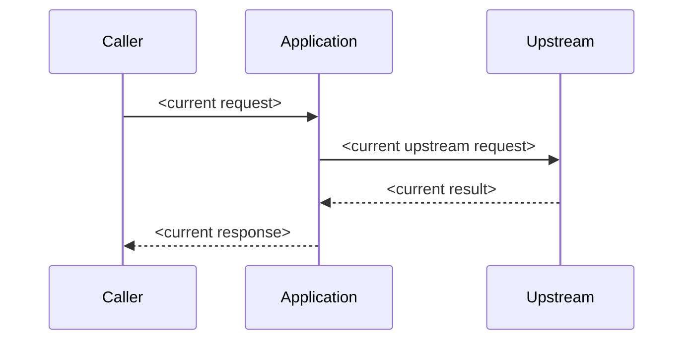
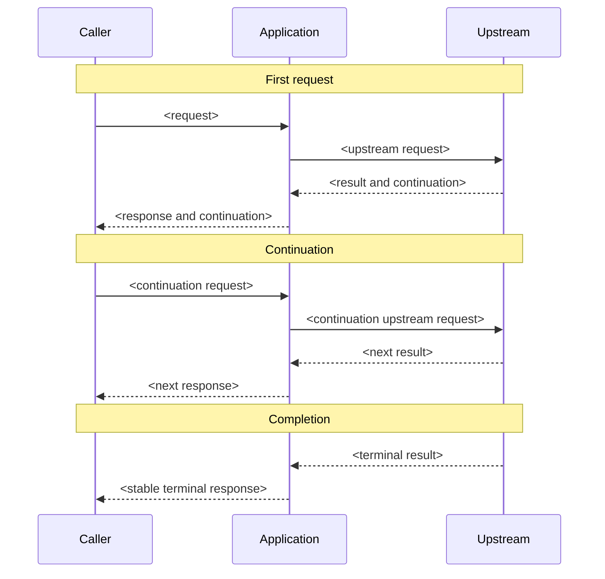

# <Change title>

- **Gate:** READY | BLOCKED
- **Source request:** <link or path to the request, issue or design this spec answers>

## Verdict

<One paragraph. State the selected design, why it is the smallest safe change, and the compatibility boundary.>

## Evidence

- `<path>:<symbol or line>`: <material fact>.
- `<test path>:<example>`: <behavior already pinned>.
- `<contract path>:<schema>`: <published contract>.
- Missing or conflicting evidence: <what was searched and not found>.

## Background

<Current limitation and who it affects. Use measured facts when available.>

## Goals

- <Observable outcome>.

## Non-goals

- <Explicitly excluded adjacent work and why>.

## Global constraints

Limits for the whole change. Every task inherits them. Copy exact values.

- <Version floor, dependency limit, naming rule or platform need, with its exact value>.

## Current behavior

### Call chain

| Layer | Symbol | Behavior | Outcome |
|---|---|---|---|
| Entry | `<symbol>` | <behavior> | <outcome> |

### Current flow



### Current request

```json
{}
```

### Current response

```json
{}
```

## Proposed behavior

### Request modes

| Mode | Discriminator | Required | Optional | Forbidden or ignored | Terminal signal |
|---|---|---|---|---|---|
| Existing | <condition> | <fields> | <fields> | <fields> | <signal> |
| New | <condition> | <fields> | <fields> | <fields> | <signal> |

### Proposed flow



### Lifecycle

1. First request: <behavior>.
2. Continuation: <behavior>.
3. Last non-empty result: <behavior>.
4. Completion: <exact caller stop condition>.
5. Early cancellation: <cleanup>.
6. Expiration: <outcome and recovery>.
7. Retry: <safe or unsafe, with reason>.

## API contract

### Request fields

| Field | Type | Required in | Validation | Default | Notes |
|---|---|---|---|---|---|
| `<field>` | <type> | <mode> | <rule> | <value> | <semantics> |

### Validation precedence

1. <First guard and exact error>.
2. <Second guard and exact error>.

### Responses

| Mode | Status | Exact shape |
|---|---|---|
| Existing | 200 | `<shape>` |
| New | 200 | `<shape>` |
| Terminal | 200 | `<shape>` |
| Cleanup | 200 | `<shape>` |

## Error catalog

Labels are spec and test identifiers unless the runtime contract already exposes an error code.

| Label | HTTP or outcome | Trigger | Exact response | Likelihood | Caller recovery | Compatibility |
|---|---|---|---|---|---|---|
| E400-1 | 400 | <trigger> | `<body>` | <likelihood> | <recovery> | New-only |

## Backward compatibility

### Hard guarantees

1. <Guarantee>. Proved by <test>.
2. <Guarantee>. Proved by <test>.

### Intentionally additive changes

- <New request field or response key>.

### Unchanged surfaces

- <Endpoint, model, job, or client that remains untouched>.

## Maintenance contract

| Hazard | Single owner | Prevention | Parity test |
|---|---|---|---|
| <behavior drift> | `<symbol>` | <rule> | <test> |

## File map

One responsibility per file. Files that change together live together.

| File | Create or modify | One responsibility | Task |
|---|---|---|---|
| `<path>` | Create | <what this file owns> | T1 |

## Task registry

| Task | Covers | Depends on | Order | Files | Verification |
|---|---|---|---:|---|---|
| T1 | <goal or mode> | <task id or none> | 1 | `<path>`, `<path>` | `<command>` |

## Implementation map

### T1 — `<path>`

- Symbol: `<symbol>`.
- Change: <smallest required change>.
- Keep unchanged: <existing behavior>.
- Focused verification: `<command>`.
- Consumes: <exact names and signatures from earlier tasks, or none>.
- Produces: <exact names, parameters and return types that later tasks rely on>.
- Steps:
  - [ ] Write the test `<test name>` with these assertions: <exact assertions and values>.
  - [ ] Run `<command>`. Expect it to fail with: `<failure text>`.
  - [ ] Implement `<name(params) -> return type>` in `<path>`. <One line on the approach, only if a real choice is left>.
  - [ ] Run `<command>`. Expect: `<output that means it passed>`.

## Traceability

| Goal or mode | Task | Test IDs | Gap |
|---|---|---|---|
| <goal> | T1 | S1, R1 | none |

## Test coverage

### New behavior

| ID | Given | When | Then |
|---|---|---|---|
| S1 | <setup> | <action> | <exact assertions> |

### Validation and upstream errors

| ID | Given | When | Then |
|---|---|---|---|
| V1 | <invalid input> | <action> | <status, body, and no downstream call> |

### Regression

| ID | Given | When | Then |
|---|---|---|---|
| R1 | <existing request> | <action> | <exact unchanged behavior> |

### Blind spots

Up to five inputs or conditions the request implies, that no row above exercises, and that are most likely to hurt a real user. Most likely first. Write "none found" only after you checked.

| Input or condition | Expected behavior | Test ID | Owning task |
|---|---|---|---|
| <input or condition> | <what a reasonable person expects> | B1 | T1 |

### Deliberately not covered

- <External behavior owned by an upstream or unavailable integration environment>.

## Rollout and verification

1. Run `<focused test command>`.
2. Run `<broader regression command>`.
3. <Optional smoke test with exact success and stop conditions>.
4. Roll back by <reversible action>.

## Adversarial review

<State who reviewed (fresh subagent) and what they were given, or state the skip and why the change is small
enough that the step 11 self-check already covers it.>

| Finding | Bucket | Resolution |
|---|---|---|
| <finding> | Act on \| Consider \| Noted \| Dismissed | <folded in / surfaced to user / reason dismissed> |

## Hand-off

- **Reviewer:** <name or "user">. Question asked: "Does this plan capture what you want?"
- **Execution choice:** one executor per task (a fresh agent per task and a fresh reviewer, coordinated by `coordinator`) | one session (`tdd` in this session, then `second-opinion` on the whole branch) | already chosen by the user: <which>.
- **Recommendation:** <one of the two, and one reason from this plan: how much the tasks depend on each other's interfaces, how many tasks there are, what a shipped mistake would cost>.
- **Saved to:** `<path>`.

## Execution checklist

- [ ] No unresolved technical choice remains.
- [ ] Existing contract is cited and preserved.
- [ ] Every mode has a terminal state.
- [ ] Validation precedence is deterministic.
- [ ] Every error has recovery guidance.
- [ ] Shared behavior has one owner.
- [ ] Every compatibility guarantee has a regression test.
- [ ] Every task has a stable ID, dependency order, and verification command.
- [ ] Traceability has no orphan goal, task, or test.
- [ ] Every "Act on" review finding is resolved.
- [ ] Scope excludes unrelated cleanup.
- [ ] Global constraints are listed with exact values.
- [ ] The file map gives every file one responsibility.
- [ ] Every task lists what it consumes and produces.
- [ ] No step says "TBD", "handle edge cases" or anything else that decides nothing.
- [ ] No step carries a body that the signature and tests already decide.
- [ ] Names and signatures match across tasks.
- [ ] Blind spots are listed, and each has a test in the owning task.
- [ ] The plan is proportional to the request.
- [ ] The user was offered the execution choice, with a recommendation.
