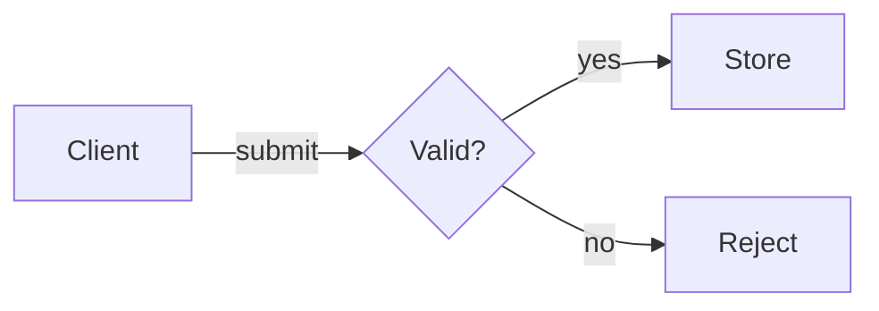

# Mermaid views

Choose the grammar from the question. Use the repository's installed Mermaid version and verify the destination's support. A local render does not prove a Markdown host supports the same features.

| Question | Grammar | Preserve |
|---|---|---|
| What decisions route this process? | `flowchart` | Labeled branches, loops, start/end and scope |
| Who sends what, and when? | `sequenceDiagram` | Participant order, message direction, responses, async work and `alt`, `opt`, `loop`, `par` blocks |
| Which states and transitions exist? | `stateDiagram-v2` | Initial/final states, event labels, guards, composite states and concurrency |
| What do these entities relate to? | `erDiagram` | Optionality, cardinality, identifying relationships and keys |
| What are the relevant classes or interfaces? | `classDiagram` | Visibility, inheritance, composition and multiplicity. Include only the requested level |
| What systems, components or hosts exist? | `flowchart` with explicit boundaries | One abstraction level and named edge meaning |

C4 or architecture-specific syntax can work when the host supports it. Use an equivalent flowchart only after checking that the conversion preserves the view's meaning. Preserve the original if a renderer cannot handle it. Report unsupported grammar rather than silently approximating it.

## Author and check

Use stable IDs and quoted display labels. Keep one relationship per line for readable diffs. Prefer a clear reading direction and direct labels. Separate containment from execution. Two boxes in a group do not imply that one calls the other.

For process flows, label every decision branch. Use lanes for ownership and explicit arrows for handoffs. For sequences, distinguish an accepted request from completed work. Draw real failures or scope the title to the happy path. For states, label the event or guard rather than describing a screen position.

Example from the fictional fixture:

Mermaid supports `accTitle` and `accDescr` for an accessible name and description. Keep a nearby prose or relationship-table equivalent when the graph is complex. Check the actual SVG and host output. See the [official accessibility guide](https://mermaid.js.org/config/accessibility.html).

Use local configuration for theme and security settings. Do not lower the renderer's security mode to make an imported click handler work. Strip or review active behavior and remote resources before rendering untrusted sources.

## Markdown and batches

Inspect each fenced block and its surrounding context. A documentation example inside an outer code fence is literal text, not an executable diagram. Match opening and closing fence characters and lengths. Preserve the original Markdown unless the user requested replacement.

Write one descriptive `.mmd` filename per figure. For many blocks, produce a manifest with input path, block position, output, title and status. Render each independently so one failure does not hide another. Reuse the source from a prior run and avoid duplicate image references.

For terminal use, provide a compact ASCII or Unicode view plus the original source. Check width, wrapping and direction. A renderer such as [beautiful-mermaid](https://github.com/lukilabs/beautiful-mermaid) supports a subset of Mermaid and text output. Check its installed API and grammar before using it. It is an optional local path, not a bundled dependency.

Use the export guide linked from `SKILL.md` for `mmdc`, PNG and GIF. The native inspector does not parse Mermaid grammar. Successful rendering and a semantic comparison are both required.

Some subset renderers treat accessibility directives as node declarations or emit CSS variables and remote font imports. If this happens, keep the original source, create a documented compatible render copy, preserve the accessible metadata in the output, and compare every node and edge. Resolve theme values for the actual rasterizer and remove external font dependencies when a local output is required.
