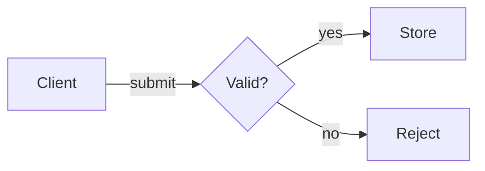

# Mermaid views

Pick the grammar from the question. Use the Mermaid version installed in the repo. Check what the destination host supports. A good local render does not prove the host supports the same features.

| Question | Grammar | Keep |
|---|---|---|
| What decisions route this process? | `flowchart` | Labeled branches, loops, start/end, scope |
| Who sends what, and when? | `sequenceDiagram` | Participant order, message direction, replies, async work, `alt`, `opt`, `loop`, `par` |
| Which states and transitions exist? | `stateDiagram-v2` | Start/end states, event labels, guards, composite states, concurrency |
| What do these entities relate to? | `erDiagram` | Optionality, cardinality, keys, identifying links |
| What classes or interfaces matter? | `classDiagram` | Visibility, inheritance, composition, multiplicity at the requested depth |
| What systems, components, or hosts exist? | `flowchart` with clear boundaries | One abstraction level, named edges |

C4 or other architecture syntax works when the host supports it. Swap to an equivalent flowchart only if meaning stays the same. Keep the original when the renderer cannot handle it. Say when grammar is unsupported. Do not silently guess.

## Author and check

Use stable IDs and quoted labels. Put one relationship per line for clean diffs. Pick a clear reading direction. Label edges in plain words. Containment is not the same as a runtime call. Two boxes in one group do not mean one calls the other.

For process flows, label every branch. Use lanes for ownership. Use explicit arrows for handoffs. For sequences, separate an accepted request from finished work. Draw real failures, or say the diagram is happy-path only. For states, label the event or guard, not a screen position.

Example from the fictional fixture:

Mermaid supports `accTitle` and `accDescr` for name and description. Add a short prose table when the graph is dense. Check the SVG and the host output. See the [official accessibility guide](https://mermaid.js.org/config/accessibility.html).

Use local theme and security settings. Do not weaken security to make an imported click handler work. Strip or review scripts and remote resources before you render untrusted input.

## Markdown and batches

Read each fenced block and the text around it. A mermaid sample inside an outer code fence is literal text, not a diagram to run. Match opening and closing fence marks and length. Keep the original Markdown unless the user asked you to replace fences.

Use one clear `.mmd` file name per figure. For many blocks, write a manifest with source path, block index, output path, title, and status. Render each block on its own so one failure does not hide the rest. Reuse prior source. Avoid duplicate image links.

For terminal use, give a compact ASCII or Unicode view plus the source. Check width, wrapping, and direction. [beautiful-mermaid](https://github.com/lukilabs/beautiful-mermaid) supports a subset of Mermaid as text. Check its API before you use it. It is optional, not bundled.

For `mmdc`, PNG, and GIF, follow the export guide from `SKILL.md`. For publish batches or Mermaid-source GIF motion, use the batch export and Playwright GIF guides in the skill table. Compare Playwright GIFs with the offline SVG walk when both are options. The native inspector does not parse Mermaid grammar. You need a successful render and a semantic check.

Some subset renderers treat accessibility directives as nodes, or emit CSS variables and remote fonts. When that happens, keep the original source, make a documented render copy, keep accessible metadata, and compare every node and edge. Resolve theme values for the rasterizer you use. Drop external font deps when you need a fully local file.
