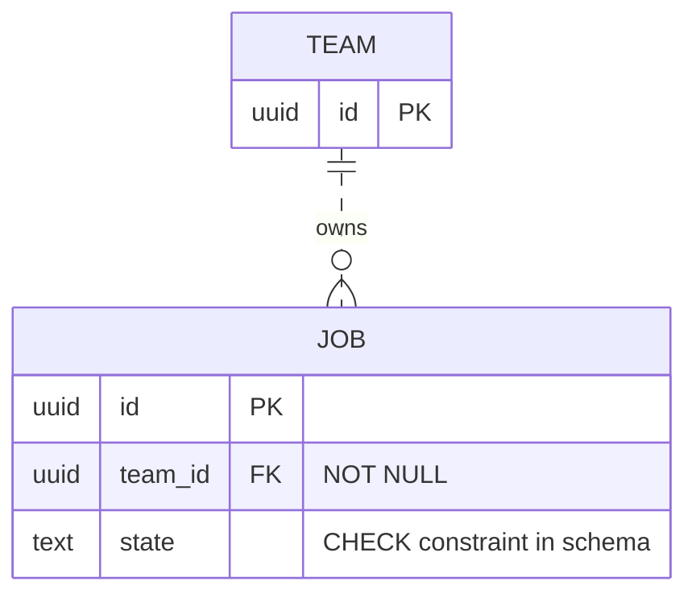

# ER and physical schemas

State whether the view describes the current database or proposes a model. Read current migrations, schema definitions and relevant access paths. For a proposal, record entities, invariants, read/write patterns, storage engine and scale assumptions first.

## Choose the level

A conceptual ERD shows domain entities and cardinality. A physical schema view shows tables, columns, SQL types, constraints, indexes and referential actions. Keep those levels distinct. For document stores, show embedded data and references explicitly rather than inventing SQL constraints.

For each relationship, record the source and target fields, nullability, uniqueness, enforcement and delete/update behavior. A nullable foreign key permits an absent parent. A foreign key alone does not require the parent to have children. Do not infer a one-to-one relation without its uniqueness constraint.

In a physical view, attach an FK to its actual column and referenced key. Include composite key columns together. Name omitted columns and link the authoritative schema. An overview can omit detail if its scope says so.

## Mermaid ER syntax

This fictional example says every job has one team and each team may have zero or many jobs. The dotted link denotes a non-identifying relationship because the team key does not form the job's identity. Mermaid uses `--` for identifying and `..` for non-identifying relationships. Its key markers are `PK`, `FK` and `UK`. Put nullability and other constraints in comments or a companion table. Check the [official ER syntax](https://mermaid.js.org/syntax/entityRelationshipDiagram.html), since older examples can reverse line meanings or use unsupported key markers.

## Review a proposed schema

- Start with entity identity and invariants. Use normalization to expose dependencies. Denormalize only for a named access pattern with an update strategy.
- Choose types for actual values and precision. Keep exact quantities exact. Name timezone and representation requirements.
- Show required, unique, check and foreign-key constraints where the database can enforce them. State application-only invariants separately.
- Use junction entities for many-to-many relationships when they carry identity or attributes. Explain polymorphic references and their enforcement limits.
- Choose indexes from queries, join paths and ordering. Record the query and write cost. Do not assert that every column needs an index or that one universal column-order rule proves performance.
- Keep migration, compatibility, backfill and rollback concerns in a proposal note. A diagram request does not authorize a migration or database mutation.

For implementation or performance tuning, hand the model and query evidence to the appropriate database skill. Do not claim an index is effective until it is measured in the target engine with representative data.
